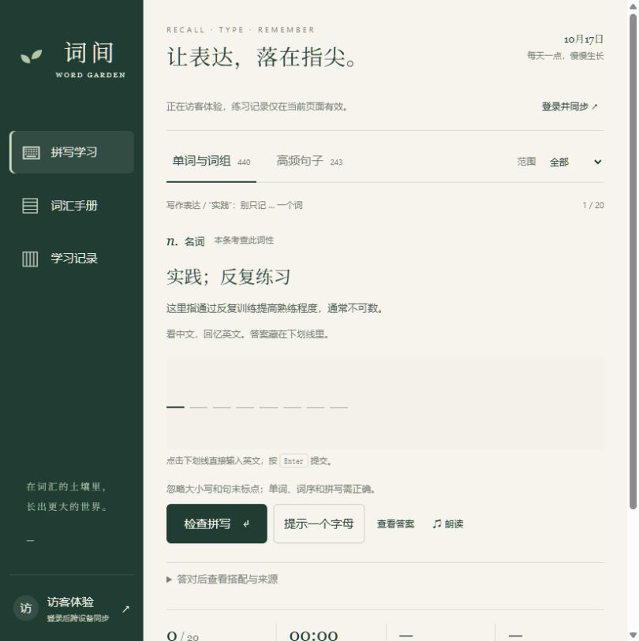
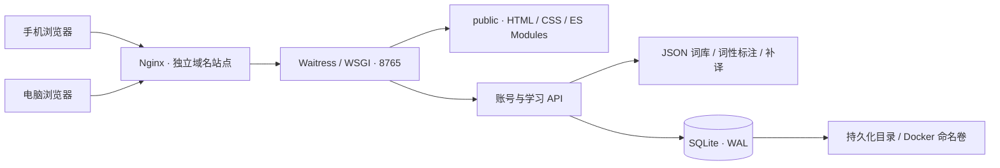
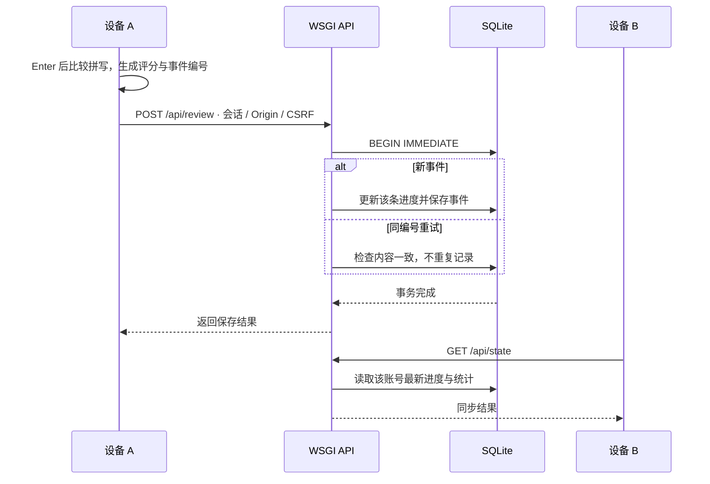

<div align="center">

# 词间 · Word Garden

**看中文，回忆英文。把认识的词，变成能写出的表达。**


[功能亮点](#功能亮点) · [实现与架构](#实现与架构) · [快速开始](#快速开始) · [服务器部署](#服务器部署) · [验证](#验证)

</div>

词间是一款面向大学英语六级写作与翻译的自托管默写网站。它把单词、词组和完整例句放进同一条学习流程：阅读中文与词性提示，在下划线上输入英文，按 Enter 检查，再按学习记录安排复习。

登录同一账号后，手机和电脑共享服务器上的进度。前端没有构建步骤，后端使用 Python、Waitress 和 SQLite；一台服务器即可部署应用与数据，无需接入外部账号服务或云端模型 API。

## 为什么做词间

阅读时认得一个词，并不总能在写作时把它拼出来。词间把练习重点放在主动回忆与语境表达上。

| 学习中的问题 | 项目的处理方式 |
| --- | --- |
| 英文一直显示，容易变成照抄 | 默认隐藏答案，只在字母下划线中显示自己输入的内容 |
| 中文释义太宽，难以确定考查义项 | 展示本条词性、短语类型；单词增加中文语境，兼类词区分当前义项 |
| 单词记住了，写作仍不会组织表达 | 将词、搭配、例句与句架纳入同一个可检索词库 |
| 手机和电脑各练各的 | 按账号保存复习事件和进度，切换设备自动读取 |
| 练过后不知道何时再练 | 优先安排到期条目，再安排新内容；错误或使用提示后提前重练 |

## 功能亮点

| 能力 | 已实现的行为 |
| --- | --- |
| 下划线默写 | 直接点击下划线输入，Enter 后判对错；提交前不标出正确字母 |
| 分层学习内容 | **683 条内容：89 个单词、351 条词组、243 条句子或句架** |
| 词性与整句中文 | 440 条词汇均有词性或短语类型；175 条缺少整句中译的例句已补译 |
| 渐进提示 | 字母提示、查看答案、浏览器朗读；使用提示后不计为独立掌握 |
| 间隔复习 | 独立正确后间隔 1、3、至少 7 天，后续延长至最多 180 天；错误或提示后 10 分钟重练 |
| 跨设备同步 | 每条练习独立提交；页面恢复可见及每 30 秒拉取进度，事件编号避免重试重复计数 |
| 学习记录 | 每日目标、北京时间统计、连续学习天数、待复习与已掌握数量、个人 JSON 导出 |
| 自托管账号 | 管理员创建账号、用户修改密码、账号数据隔离、命令行在线备份 |

### 实际页面

下图为应用的真实访客页面：词性与中文语境可见，英文答案保留为空白下划线。顶部植物封面由 AI 生成，未将概念图作为产品截图。

<p align="center">
  
</p>

### 一轮学习如何进行

1. 选择“单词与词组”或“高频句子”，按写作、翻译范围练习。
2. 阅读中文释义、词性与当前语境，在下划线中直接输入。
3. 按 Enter 检查；错误时修改输入，正确后进入下一条。
4. 需要时使用提示；系统记录这次是否依赖提示。
5. 登录用户的练习写入服务器，下次优先练习到期内容。

拼写比较会统一大小写、常见句读、引号和多余空格。单词与词序仍须正确，同义改写不会自动判为正确。含占位符的句架不进入默认队列，可从词汇手册单独练习。

## 实现与架构



前端和 API 使用同一个站点来源，减少单独维护跨域规则的工作。后端按模块分开处理账号、请求边界、数据库和复习规则。静态文件只从 `public/` 提供，源码与数据库不会作为网站文件公开。

### 一次练习如何同步到另一台设备



同步以单条事件为单位，避免两个设备用整份本地进度互相覆盖。同一账号、同一事件编号只记一次；这是自学记录机制，拼写判定在前端完成。

### 技术选择

| 层次 | 实现 | 维护上的考虑 |
| --- | --- | --- |
| 页面 | 原生 HTML、CSS、JavaScript ES Modules | 无前端依赖安装与打包步骤 |
| HTTP | Python 3.11+、Waitress 3.0.2 | 单个 WSGI 应用同时提供页面与接口 |
| 数据 | SQLite、WAL、短事务 | 适合个人及少量账号的单实例部署 |
| 内容 | JSON 词库、TSV 义项、Python 导入脚本 | 内容与账号记录分开，可追溯到资料章节 |
| 部署 | Docker Compose、Nginx | 容器端口仅映射回环地址，复用反向代理 |
| 验证 | unittest、Node 内置测试、真实 HTTP 脚本 | 无需额外测试框架即可检查主要行为 |

### 存储与账号

| 数据表 | 保存内容 |
| --- | --- |
| `users` | 账号、密码派生值、每日目标 |
| `sessions` | 会话令牌摘要、账号、CSRF 值、过期时间 |
| `progress` | 每个账号每条内容的复习次数、间隔、到期时间、遗忘次数 |
| `events` | 独立练习事件、评分、模式、北京时间日期 |
| `login_attempts` | 账号和来源 IP 节流的短期尝试记录 |

密码使用随机盐与 scrypt 派生；会话令牌仅保存 SHA-256 摘要。Cookie 使用 HttpOnly、SameSite=Lax，在配置 HTTPS 来源时增加 Secure。写入接口检查来源，登录后的写入还检查 CSRF；登录失败按账号与来源 IP 限速。会话有效期为 14 天，修改密码会使已有会话失效。

## 快速开始

需要 Python 3.11 或以上版本。在项目根目录执行：

```bash
python -m venv .venv
```

激活虚拟环境，Windows PowerShell 使用：

```powershell
.\.venv\Scripts\Activate.ps1
```

Linux / macOS 使用：

```bash
source .venv/bin/activate
```

安装唯一第三方运行依赖并启动：

```bash
python -m pip install -r requirements.txt
python serve.py
```

浏览器打开 [http://localhost:8765](http://localhost:8765)。访客可直接体验，记录仅在当前页面有效，刷新后不会保留。登录账号的记录保存在服务器。

在另一个终端、同一个虚拟环境中创建账号：

```bash
python manage.py create-user learner
```

密码通过隐藏输入设置，长度为 12–128 个字符。账号名为 3–32 个英文字母、数字、下划线或短横线，统一小写。网站不开放自助注册，也不提供预置账号密码。

Windows 也可使用 `start-local.ps1` 一键预览；该脚本启动的 `--dev` 开发服务器仅供本机使用。

## 服务器部署

仓库提供 Docker 与独立 Nginx 站点模板。完整 HTTP 域名部署、备份及排错步骤见 [部署指南](docs/部署与域名配置.md)。

### 先在本机验证 Docker

仓库 `compose.yaml` 默认来源为 `http://localhost:8765`：

```bash
docker compose -p wordgarden up -d --build
docker compose -p wordgarden exec wordgarden python manage.py create-user learner
curl http://127.0.0.1:8765/api/health
```

健康接口应返回 `{"status": "ok"}`。容器以普通用户运行，应用根目录只读，数据库写入命名卷。

### 再接入自己的域名

1. 为域名增加指向服务器公网 IP 的 A 记录；如设置 AAAA，确认 IPv6 也能到达同一站点。
2. 将 `compose.yaml` 中 `WORD_ORIGIN` 改为最终浏览器地址，例如 `http://words.example.com`，协议与端口必须匹配。
3. 将 `deploy/words.example.com.http.conf` 的示例域名替换为自己的域名，安装到现有 Nginx 已包含的配置目录。
4. 重建应用、检查 Nginx 配置并重载，通过健康接口验证域名分流。

```bash
docker compose -p wordgarden up -d --build
nginx -t && systemctl reload nginx
curl -H 'Host: words.example.com' http://127.0.0.1/api/health
docker compose -p wordgarden logs --tail 60 wordgarden
```

默认部署采用普通 HTTP，不自动跳转 HTTPS。公网 HTTP 会明文传输密码与会话，请使用独立密码。可选 HTTPS 模板另附在 `deploy/`，启用前需准备证书并同步修改 `WORD_ORIGIN`。

**持久化：**数据库位于命名卷 `wordgarden-data` 的 `/app/storage/wordgarden.sqlite3`。持续使用同一个 `-p wordgarden` 项目名，更新应用不会替换学习记录；`docker compose down -v` 会删除命名卷，操作前须备份。

## 配置与管理

配置来自进程变量或 `compose.yaml`，无需创建 `.env` 文件；Python 应用不会读取 `.env`。执行 Compose 时同样不要提供此类文件。

| 配置项 | 默认值 | 说明 |
| --- | --- | --- |
| `WORD_ORIGIN` | `http://localhost:8765` | 允许写入的来源，须与地址栏协议、域名、端口一致 |
| `WORD_DATA_DIR` | 项目下 `storage/` | SQLite 数据目录；容器中设为 `/app/storage` |
| `serve.py --host` | `127.0.0.1` | 容器入口改为 `0.0.0.0`，宿主机端口仍只映射回环地址 |
| `serve.py --port` | `8765` | 应用监听端口 |

```bash
# 查看账号
python manage.py list-users

# 管理员重设密码，同时使旧会话失效
python manage.py reset-password learner

# 在线备份数据库，目标文件必须尚不存在
python manage.py backup backups/wordgarden-20261017.sqlite3
```

Docker 中执行管理命令时，在前面加 `docker compose -p wordgarden exec wordgarden`。备份到 `/app/storage/` 后使用 `docker compose cp` 复制出容器，具体示例见部署指南。个人 JSON 导出用于查阅，完整迁移与恢复应使用数据库备份。

## 学习资料与再导入

词库来自提供给项目的《CET6_近十年写作翻译范文与高频表达》。资料名称中的“近十年”“高频”沿用原编排，项目没有重新统计词频；新增中译属于教学补译，参考英文也不是官方唯一答案。

| 文件 | 用途 |
| --- | --- |
| `docs/source-material.md` | 保留来源章节的学习资料 |
| `data/catalog.json` | 服务启动时加载的运行词库 |
| `data/sentence-translations.json` | 与稳定 ID 对应的 175 条新增整句译文 |
| `data/word-senses.tsv` | 单词的词性、义项、语境和用法标注 |
| `public/assets/grammar.json` | 前端词性与提示元数据 |

修改资料或人工标注后，在项目根目录重新导入，并重启服务：

```bash
python tools/import_material.py docs/source-material.md
```

导入器按英文内容生成稳定 ID，合并已有补译并生成词性元数据。更改英文原文会改变 ID，应同时检查补译映射及已有学习记录的关联。句子/句架共 243 条，其中 55 条标记为模板，不进入默认练习队列。

## 验证

在仓库根目录执行：

```bash
# 后端：临时数据库上的账号、同步与数据边界测试
python -m unittest discover -s tests -v

# 前端：需要支持 node:test 的 Node.js，不需要 npm install
node --test tests/typing.test.js tests/prompts.test.js

# 真实 Waitress：临时服务上的两个独立会话与持久化
python tools/verify_http.py
```

现有自动检查包括 10 项后端测试、7 项前端测试，以及真实 HTTP 下的登录、两设备会话读取、重试去重、重启持久化、导出与在线备份。真实 HTTP 脚本使用临时数据目录和 `8766` 端口，不写入正式账号数据库。

镜像构建、主机 Nginx、DNS 与手机实机访问须在部署环境单独验证，本地测试通过不等于完成公网部署。

## 项目结构

```text
word-garden/
├── backend/            # WSGI 路由、认证、SQLite、复习与统计
├── public/             # 页面、样式、ES Modules 与网站插画
├── data/               # 运行词库、义项标注和补译
├── tools/              # 资料导入、标注合并、真实 HTTP 验证
├── tests/              # Python 与 JavaScript 测试
├── deploy/             # 独立 Nginx 站点与续期重载脚本
├── docs/               # 部署、资料来源、图像来源与设计说明
├── design/             # 原始界面设计参考，非产品截图
├── manage.py           # 账号管理与在线数据库备份
├── serve.py            # Waitress / 本地开发入口
├── compose.yaml        # 回环端口、持久化卷与容器限制
└── Dockerfile          # 普通用户运行与构建时权限检查
```

## 使用范围

- 面向个人及少量账号的单实例场景，大规模并发写入需重新设计存储与部署方式。
- 需要联网保存记录，尚无离线持久化队列；保存失败保留当前输入供重试，刷新或关闭页面可能丢失未保存内容。
- 当前只有管理员建号，没有邮件找回、开放注册或第三方登录；朗读音色依赖设备和浏览器。
- “已掌握”使用至少 3 次独立正确且间隔不少于 7 天的规则，代表本站练习状态。
- 当前仓库未添加 `LICENSE`，学习资料与生成图片的来源见下方文档。

## 进一步阅读

- [部署与域名配置](docs/部署与域名配置.md)
- [词性与提示修正说明](docs/词性与提示修正.md)
- [界面设计与插画生成记录](docs/设计说明.md)
- [README 封面及截图来源](docs/README图片来源.md)
